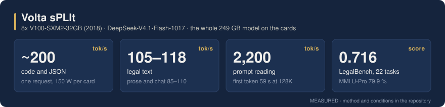
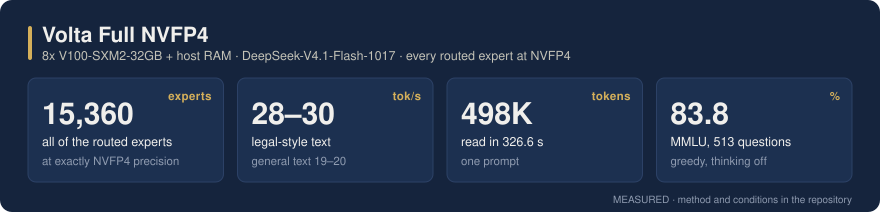
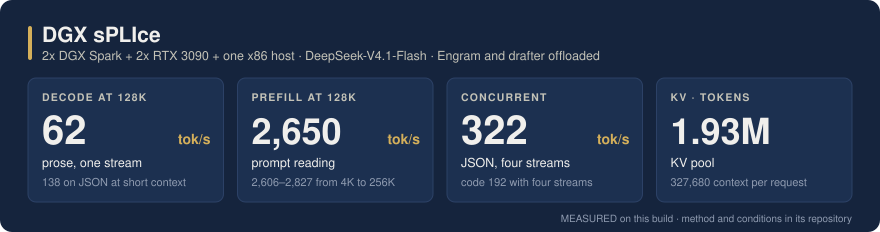

# PLI Labs — Proprietary Legal Intelligence

Your proprietary work product is your proprietary intelligence.

**Nick Mermiges, Esq.** is a trial lawyer in Columbia, South Carolina, with more than eleven years of civil litigation, trials and appeals, and the founder of Proprietary Legal Intelligence. He runs his own litigation practice on AI every day and helps small and mid-sized civil litigation firms find where their work backs up and fix it. PLI Labs publishes the open research from that work: everything here was built first inside a working trial practice, on hardware he owns.

[Website](https://proprietarylegal.ai) · [Claude workflows](https://proprietarylegal.ai/frontier.html) · [Local models](https://proprietarylegal.ai/local.html) · [PLI Labs](https://proprietarylegal.ai/labs.html) · [Research](https://proprietarylegal.ai/research/index.html) · [Hugging Face](https://huggingface.co/ProprietaryLegal) · [Contact](https://proprietarylegal.ai/contact.html)

**In the press:** Tom's Hardware, November 9, 2026, by Shane Downing, on the eight-V100 build: [Lawyer builds private AI server with eight used Nvidia V100 GPUs — up to 215 tokens per second to keep legal files offline, costing about $2,400 per four-GPU board](https://www.tomshardware.com/tech-industry/artificial-intelligence/lawyer-builds-private-ai-server-with-eight-used-nvidia-v100-gpus-up-to-215-tokens-per-second-to-keep-legal-files-offline-costing-about-usd2-400-per-four-gpu-board).

## The builds

Every build serves DeepSeek-V4.1-Flash-1017 on hardware you can own. Each card gives that build's own MEASURED
tokens per second for decode, prefill and concurrent requests (at 128K tokens of context where the build
publishes that row) and its KV cache; its repository gives the method, the conditions and the losses beside the wins.

### [Volta 12X AmPLIfy](https://github.com/ProprietaryLegal/Volta-12X-AmPLIfy-DeepSeek-V4.1-Flash-1017-NVFP4-12xV100-SXM2-PP3xTP4)

Every routed expert at NVIDIA's NVFP4 precision on twelve cards, three pipeline stages of four.

### [Volta Max uPLIft](https://github.com/ProprietaryLegal/Volta-Max-uPLIft-FP4-DeepSeek-V4.1-Flash-1017-NVFP4-8xV100-SXM2-PP2xTP4)

As much of the routed work at NVIDIA's NVFP4 precision as fits on eight cards, every expert on the cards.

### [Volta sPLIt](https://github.com/ProprietaryLegal/Volta-sPLIt-DeepSeek-V4.1-Flash-1017-8xV100-SXM2-PP2xTP4)

The whole 249 GB model resident on eight 2018 cards.

### [Volta Full NVFP4](https://github.com/ProprietaryLegal/Volta-Full-NVFP4-DeepSeek-V4.1-Flash-8xV100)

Every routed expert at exactly NVFP4 precision on eight cards, the less-used ones served from host RAM.

### [DGX sPLIce](https://github.com/ProprietaryLegal/DGX-sPLIce-DeepSeek-V4.1-Flash-2xDGX-Spark-2xRTX3090-drafter-x86-offload)

Two DGX Sparks serve the model; an x86 machine holds the Engram tables in RAM over RDMA and runs the drafter on two RTX 3090s.

## The research

### [Volta V100 research](https://proprietarylegal.github.io/volta-v100-research/)

The long read and the source research behind the Volta builds: the card's architecture, every optimization build
by build (with the ones that lost), the test method, kernel building for sm_70, and a
[hardware list with links](https://proprietarylegal.github.io/volta-v100-research/hardware.html) for building your
own boards. [Repository](https://github.com/ProprietaryLegal/volta-v100-research).

## The skill

### [PLI Volta Builder](https://github.com/ProprietaryLegal/pli-volta-builder)

An agent skill for Claude Code and Codex that runs the campaign behind these builds on your own cards: intake,
upstream first, layout arithmetic, a test harness with strict judges, a measured time budget, a gated
hill-climbing loop that keeps only what passes, kernels, independent review, publishing. Install with
`./install.sh --both`.

## More

Components, earlier builds and mirrors of upstream work are under
[all repositories](https://github.com/ProprietaryLegal?tab=repositories).

PLI Labs is the open research arm of Proprietary Legal Intelligence. We publish methods, code and measured results
so you can inspect the work before hiring us. For AI systems on approved frontier APIs, private cloud or hardware
you own, [reach us through the contact page](https://proprietarylegal.ai/contact.html).

Proprietary Legal Intelligence LLC is a technology consultancy, not a law firm, and does not provide legal services or legal advice.
